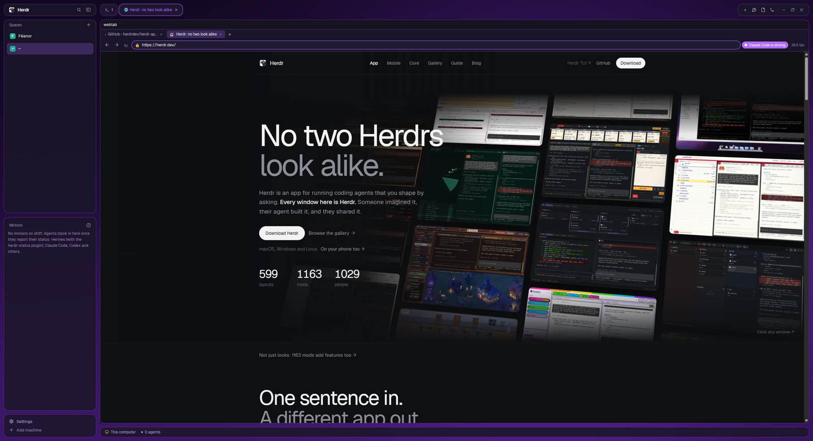
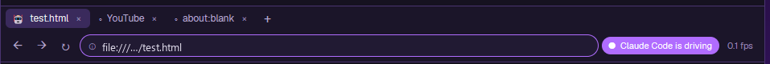
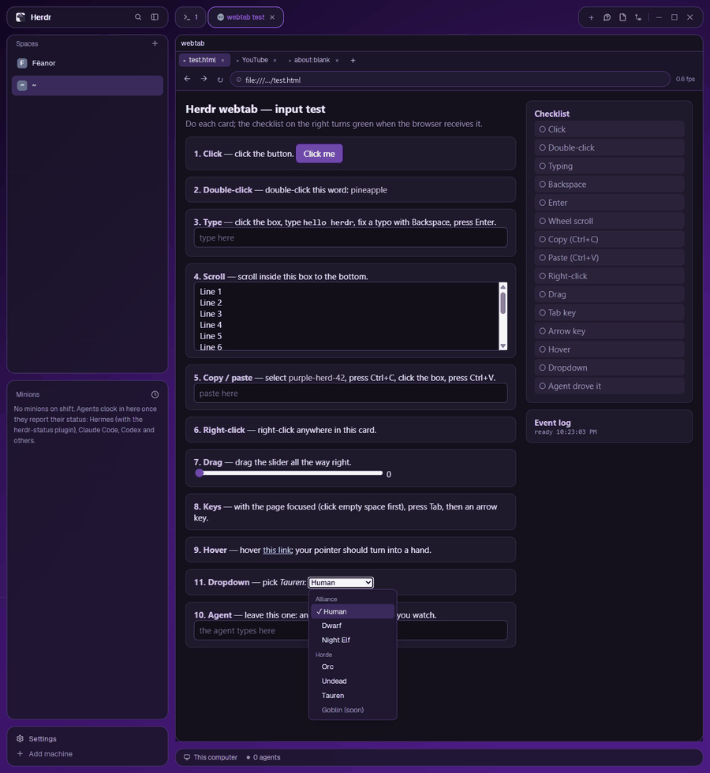

# Herdr Web Tab

A real Chromium browser tab, drawn natively inside the [Herdr](https://herdr.dev) desktop app, that you
and your coding agents share. You browse it like any tab. Claude Code, Codex, pi, or anything that
speaks the Chrome DevTools protocol can drive the same browser at the same time. You see every click
they make, and a badge tells you who's driving.



## Why

Coding agents use browsers all the time: checking a dev server, reading docs, testing a login flow.
Usually that browser is invisible (headless) or a separate window you have to babysit. Herdr Web Tab
puts it **in a Herdr tab next to the agent's terminal**, drawn by Herdr itself (GPUI, no web view, no
floating window). The page is the agent's and yours at once.

## What you get

- **A web tab in Herdr:** an address bar with search, back/forward/reload, a loading spinner, and
  link and text cursors. The Herdr tab is named after the page.
- **Browser tabs:** a tab strip lists every tab in the browser. Switch, close, or open tabs; Ctrl+T and
  Ctrl+W work too.
- **Real input:** click, double-click, drag, scroll, type, Tab and arrow keys, copy and paste, and
  right-click.
- **Dropdowns and dialogs:** `<select>` menus, `alert`, `confirm`, `prompt` and "leave this page?" are
  drawn by Herdr in its own theme. Headless Chromium can't draw them.
- **"Who's driving":** when an agent acts on the page you're looking at, a badge says
  "Claude Code is driving" (or whichever agent), and a 🤖 marks every tab an agent touched.
- **Sharp on high-resolution screens:** frames are rendered at your display scale.
- **Agents set up for you:** one command registers a `webtab` MCP server
  ([chrome-devtools-mcp](https://github.com/ChromeDevTools/chrome-devtools-mcp)) with Claude Code,
  Codex and pi. It also adds a note to Herdr's agent instructions (`AGENTS.local.md`), so agents in
  Herdr know the browser is there and how to show you a page.
- **Starts on demand:** the browser engine starts when a web tab opens or an agent's MCP server
  starts. Nothing runs at login unless you ask for it.

## Install

You need the **Herdr desktop app** (tested with 0.1.18), **Node 22+**, and **Chrome, Chromium, Brave
or Edge**.

```sh
git clone https://github.com/Stormxftw/herdr-webtab
cd herdr-webtab
node install.mjs
```

Or ask your Herdr agent: *"add the mod at github.com/Stormxftw/herdr-webtab and run its install.mjs"*.

| Option | What it does |
|---|---|
| `--menu` | Adds a **Web tab** row to the + menu of your own tab bars (backups kept; Herdr's shipped tab bar is never edited) |
| `--key [chord]` | Binds a key to "New web tab" (default `ctrl-shift-y`, `cmd-shift-y` on macOS). Herdr then treats `keys.json` as yours, so later default keys must be added by hand |
| `--autostart` | Also starts the engine at login (Windows Startup, a macOS LaunchAgent, or Linux XDG autostart) |
| `--no-agents` | Skips the MCP server and the agent note |
| `--chrome <path>` | Uses this browser binary |
| `--profile <dir>` | Keeps the browser profile here (default `~/.config/herdr-app/data/webtab/profile`) |
| `--install-chromium` | Downloads Playwright's Chromium if no browser is found |

Re-run `node install.mjs` after updating this repo or Herdr; it updates in place. To remove
everything, run `node uninstall.mjs` (add `--purge` to also delete the browser profile and settings).
Uninstalling closes any open web tabs.

**Manual install (no Node scripts):** copy `mods/webtab` and `mods/webtab-new` into
`~/.config/herdr-app/mods/`. The web tab still works and starts its engine on demand. You won't get
the MCP registration or the agent note.

## Use it

- **Command palette:** "New web tab".
- **+ menu:** "Web tab", if you installed with `--menu`.
- **From a terminal or an agent:**
  `herdr-app do tab.new '{"name":"🌐 Web","mod":"webtab","props":{"id":"docs","url":"https://example.com"}}'`

Keys while the page has focus: **Ctrl+L** address bar, **Ctrl+T** new tab, **Ctrl+W** close tab,
**Ctrl+R / F5** reload, **Alt+←/→** back/forward, **Ctrl+C / Ctrl+V** copy and paste. On macOS, Cmd
works in place of Ctrl.

### For agents

The installer registers the MCP server `webtab` and explains the rest to agents in
`~/.config/herdr-app/AGENTS.local.md`. In short:

- **Drive the browser:** use the `webtab` MCP tools (`new_page`, `navigate_page`, `click`, `fill`,
  `take_snapshot`, …), or `connectOverCDP("http://127.0.0.1:9333")` from Playwright or Puppeteer.
- **Show the person a page:** open a web tab with `props.target` set to the page's CDP target id, or
  `props.url`. List tabs with `curl -s http://127.0.0.1:9441/status`.
- **Say who you are:** `curl -s -X POST "http://127.0.0.1:9441/claim?name=Claude%20Code"`. After that,
  the badge names you instead of "An agent".

## How it works

```
 Herdr window                          webtabd (Node)                     Chromium (headless)
┌──────────────────────┐  NDJSON   ┌─────────────────────┐    CDP      ┌───────────────────┐
│ webtab mod (GPUI)    │◄────────► │ screencast → JPEG   │◄──────────► │ your pages        │
│ draws frames with    │ 127.0.0.1 │ input, tabs, menus, │ 127.0.0.1   │ separate profile  │
│ image(), sends input │  :9440    │ dialogs, who-drives │   :9333     │                   │
└──────────────────────┘           └─────────────────────┘             └─────────▲─────────┘
                                     HTTP :9441 /status /claim                    │ CDP
                                                              agents: chrome-devtools-mcp, Playwright
```

Herdr mods can't embed a web view, but they can draw image files. The engine streams the page with
CDP's screencast and writes each frame as a JPEG under `~/.config/herdr-app/data/webtab/frames`. The
mod draws the newest frame and keeps the previous few drawn underneath, so a frame that's still
loading never flashes blank. When the page settles, a sharper screenshot replaces the stream frame.
Input goes back the same way. Agents talk to Chromium directly over CDP, and the engine tells them
apart from you: input and navigation that didn't come from Herdr are an agent's.

The full explanation, with diagrams, the security model and every file the installer touches, is in
**[docs/how-it-works.md](docs/how-it-works.md)**. The message-level reference is
[docs/architecture.md](docs/architecture.md).

## How it was built and tested

Nothing here is hidden. The repo includes the R&D: the approaches we tried and dropped, the
experiment scripts, the measurements, and screenshots from testing inside Herdr.

| Read | What's in it |
|---|---|
| [docs/research.md](docs/research.md) | The question, and the five approaches tried: a mod drawing CDP frames, Kitty graphics in a terminal, a real Chromium window docked into Herdr (two ways), and the engine + view design we kept. Why each was kept or dropped, with screenshots. |
| [docs/testing.md](docs/testing.md) | All 28 automated tests and why each exists, the hands-on tests in Herdr with screenshots, a real Claude Code session driving the tab, the measurements behind the design, and the hunt for flaky tests. |
| [docs/how-it-works.md](docs/how-it-works.md) | Every piece, port, file and protocol, from Chromium's pixels to Herdr's and back. |
| [experiments/](experiments/README.md) | The scripts behind all of the above, runnable. |
| [docs/upstream.md](docs/upstream.md) | The Herdr bug and missing mod APIs this work turned up, drafted as issues. |





## Security and privacy

Everything stays on your machine, and all ports listen on `127.0.0.1` only.

- **The mod's socket** needs a random token from a file in Herdr's data folder. Web pages and other
  programs can't drive the browser through it.
- **The HTTP API** refuses requests from web pages (anything carrying `Origin` or `Sec-Fetch-Site`),
  and checks `Host` against DNS rebinding.
- **Chromium runs without `--remote-allow-origins`,** so web pages can't open its DevTools socket.
  Local programs can: that's how agents reach it.
- **The browser profile is separate** from your own browser. It's signed in only where you sign in
  inside the web tab.
- **chrome-devtools-mcp** runs with usage statistics off.
- **What runs:** Node (the engine), your Chromium, and chrome-devtools-mcp. The installer downloads
  that last one from npm, pinned to 1.14.0.

See [SECURITY.md](SECURITY.md) to report a problem.

## Settings

`~/.config/herdr-app/data/webtab/config.json` (the installer creates it; restart the engine after
editing with `node ~/.config/herdr-app/mods/webtab/node/webtabd.mjs --stop`):

| Key | Default | |
|---|---|---|
| `dpr` | `"auto"` | Frame sharpness: your display scale, or a number such as `2` |
| `quality` | `72` | JPEG quality of streamed frames (settled frames use 92) |
| `home` / `search` | DuckDuckGo | New-tab page, and the search URL (`%s` = the query) |
| `chrome` / `profile` | found / data folder | Browser binary and profile folder |
| `chromeArgs` | `[]` | Extra Chromium flags, e.g. `["--no-sandbox"]` in a container |
| `port` / `httpPort` / `cdpPort` | 9440 / 9441 / 9333 | Mod socket, HTTP API, DevTools |

## Limits

- **Tested on Windows 11 with Herdr 0.1.18.** The engine and installer are tested on Windows, macOS
  and Linux in CI. The mod inside Herdr on macOS and Linux hasn't been tried yet; reports welcome.
- **Frames go through disk** (Herdr mods can only draw images from files). Expect about 20–45 fps and
  roughly a tenth of a second of extra lag. Fine for agent work and reading; video plays but isn't
  smooth. See [docs/upstream.md](docs/upstream.md) for the Herdr APIs that would fix this.
- **Not supported:** file upload pickers, downloads, extensions, printing, and drag and drop of files
  from your desktop.
- **Two web tabs on the same browser tab** share one viewport size.
- **Each web tab gets its own browser window** (all invisible). Headless Chromium paints only the
  front tab of a window, so tabs that agents open go into a separate window and can't freeze the page
  you're watching. See [docs/architecture.md](docs/architecture.md).
- **Something wrong?** The engine logs to `data/webtab/webtabd.log` in your Herdr config folder. Start
  it with `WEBTAB_DEBUG=1` for timings, tab switches and visibility changes.

## Contributing

Bug reports and pull requests are welcome; see [CONTRIBUTING.md](CONTRIBUTING.md). `npm test` runs the
engine, installer and MCP tests against a real headless Chrome.

## Credits

- [Herdr](https://github.com/herdrdev/herdr-app), whose mods make this possible.
- [ogulcancelik/herdr-browser](https://github.com/ogulcancelik/herdr-browser), which did CDP streaming
  for the Herdr TUI with Kitty graphics.
- [chrome-devtools-mcp](https://github.com/ChromeDevTools/chrome-devtools-mcp) from the Chrome
  DevTools team.

## License

[Apache-2.0](LICENSE), the same as Herdr. The + menu row extends a copy of Herdr's own `new-menu` mod
that the installer takes from your installed Herdr; that copy stays under Herdr's license.
