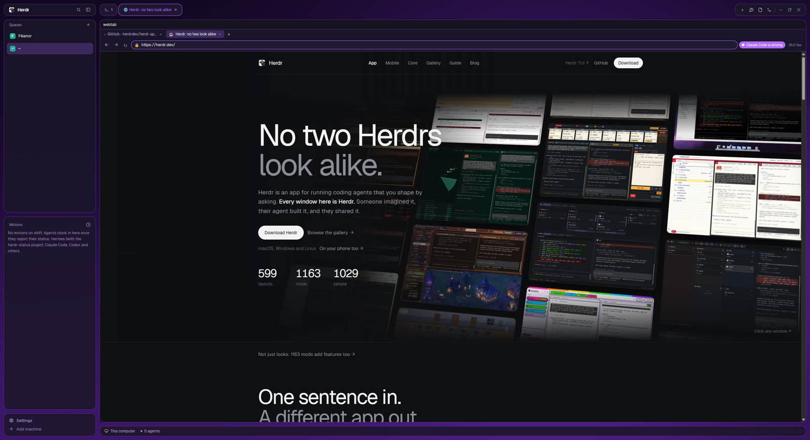

# Herdr Web Tab

A real Chromium page in a Herdr tab, drawn by Herdr itself, that the person and their coding agents
share: the person browses it, agents drive the same browser over the Chrome DevTools protocol, and a
badge says who is driving.

## What you see

Top to bottom, filling a tab (or any pane):

1. **Tab strip**, 30 px, `chrome` background: one pill per browser tab (max 200 px, title truncated,
   `◦` before it, or 🤖 for eight seconds after an agent touched that tab), the active pill on
   `selected`, a `×` on each, and a `+` at the end.
2. **Toolbar**, 40 px, `chrome` background with a bottom border: back `←`, forward `→`, reload `↻`
   (a braille spinner in `accent` while loading), the address field (28 px pill on `surface`, 🔒 in
   `done` for https, ⓘ otherwise; its border turns `accent` while an agent drives), the driving badge
   (22 px `accent` pill: a pulsing ● and "Claude Code is driving"), and the frame rate in `dim` 10.5 px.
3. **The page**: the newest frame image, white behind it. Before the first frame: a status line
   centered in `muted` ("starting the browser…").

The Herdr tab is renamed "🌐 " + the page title (24 characters).

## How it behaves

- **Mouse:** left/right press and release, double-click, moves (and drags anywhere in the window
  while a button is held), and the wheel all reach the page at the pointer's position. The cursor
  follows the page: a pointer over links and buttons, a text cursor over text and fields.
- **Keys** (when the page has focus): typing, Enter, Backspace, Tab, arrows, Home/End, Page Up/Down
  and Escape reach the page. Ctrl/Cmd+L focuses the address, +T opens a tab, +W closes it, +R or F5
  reloads, Alt+←/→ go back/forward, Ctrl/Cmd+A/C/X/Z/Y edit, and Ctrl/Cmd+V pastes the clipboard.
- **Address field:** Enter opens a URL, a bare host (`example.com`), or searches anything else.
- **`<select>`:** clicking one opens a menu drawn under it (above if there's no room), with group
  headers, a ✓ on the current option and disabled options dimmed. Up/Down/Home/End move, Enter or
  Space picks, letters jump, Escape or a click outside closes.
- **Dialogs:** `alert`, `confirm`, `prompt` and "leave this page?" show as a card over the dimmed
  page (Enter answers OK, Escape cancels; `prompt` has a field).
- **Agents:** when something other than this tab (an agent on CDP) navigates or sends input to the
  page shown, the badge appears for five seconds, naming the agent that claimed the browser, else the
  one Herdr agent that is working, else "An agent".
- A link that opens a new window takes the tab along to it.
- If the engine stops, the tab says so and reconnects, starting it again.

## Built from

- **Mods:** `webtab` (the view; `"place": "none"`, `"focusable": true`, a palette entry "New web
  tab" → `mod.open {name: "webtab-new"}`), `webtab-new` (a 1×1 overlay that runs
  `tab.new {name: "🌐 Web", mod: "webtab", props: {id}}` with a fresh `id` and closes itself), and
  optionally `new-menu-web` (subclasses a copy of the shipped `new-menu` as `base.js` and adds a
  "Web tab" row; the person's own tab bars open it instead of `new-menu`).
- **props:** `{id?, url?, target?}`: `id` keeps each tab's saved state its own (copies with equal
  props share `localStorage`); `url` opens an address; `target` shows an existing CDP target.
- **herdr:** `theme`, `exec` (starts the engine: `node <appHome>/mods/webtab/node/webtabd.mjs
  --detach`), `appHome`, `readTextFile` (config and token), `checking`, `nextCommand` (focus),
  `run("tab.rename")`, `panes`, `props`, `agents`, `focused`; `net` for the engine socket;
  `image()` for frames; `InputState`/`Input` for the address and prompt fields.
- **The engine** (`node/webtabd.mjs`, Node 22, no dependencies) owns a headless Chromium on
  127.0.0.1:9333, streams `Page.startScreencast` frames to JPEG files, takes NDJSON commands on
  127.0.0.1:9440 after a token handshake, and serves `GET /status`, `POST /claim` and `POST /quit` on
  127.0.0.1:9441. `node/mcp.mjs` starts it and runs chrome-devtools-mcp against it for agents.

## Watch out

- Mods can't write binary files (`fs.writeFile` of bytes writes 0 bytes), so frames come from the
  Node engine, not the mod.
- `image()` loads asynchronously and draws nothing until loaded: draw each new frame underneath the
  last few and promote it on the next frame (or after 35 ms), or the page flickers.
- GPUI takes Tab and the arrows before `on_key_down`: bind them with `cx.bind_keys` in a key context.
- `.absolute()` together with `overflow_y_scrollbar()` loses the position: position a plain outer
  box and scroll inside it.
- A copy retired by a reload keeps running until its next `cx` use: close the socket when the read
  loop throws, or the engine streams to nobody.
- `herdr-app check` runs `init` for real: start nothing while `checking()`.
- `props().pane` exists only for pane headers: remember the focused web tab pane at start.
- Headless Chromium draws no `<select>` popup and no dialogs; the page waits on a dialog forever.
- Chrome reports a tab's title only when its URL changes: read titles from `/json/list`.

## Done when

- "New web tab" in the palette opens a tab that shows DuckDuckGo within a few seconds and is renamed
  after the page.
- Two "New web tab"s show two different browser tabs, and both survive a mod reload.
- Clicking, typing, scrolling, dragging, Tab/arrows and copy/paste work on `test/fixtures/manual-test.html`.
- A `<select>` opens Herdr's menu and picking an option changes the page; `confirm()` shows the card.
- An agent using the `webtab` MCP server makes "… is driving" appear, and its tab gets a 🤖.
- `npm test` passes.
