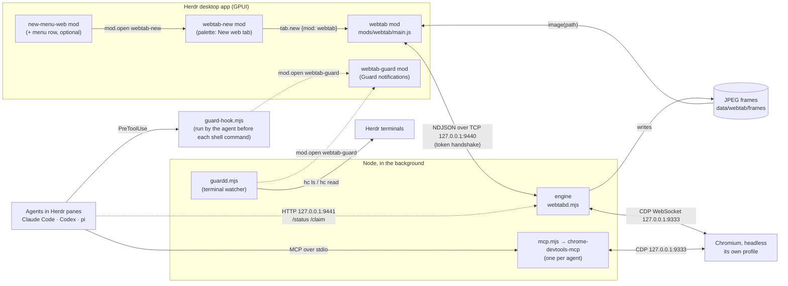
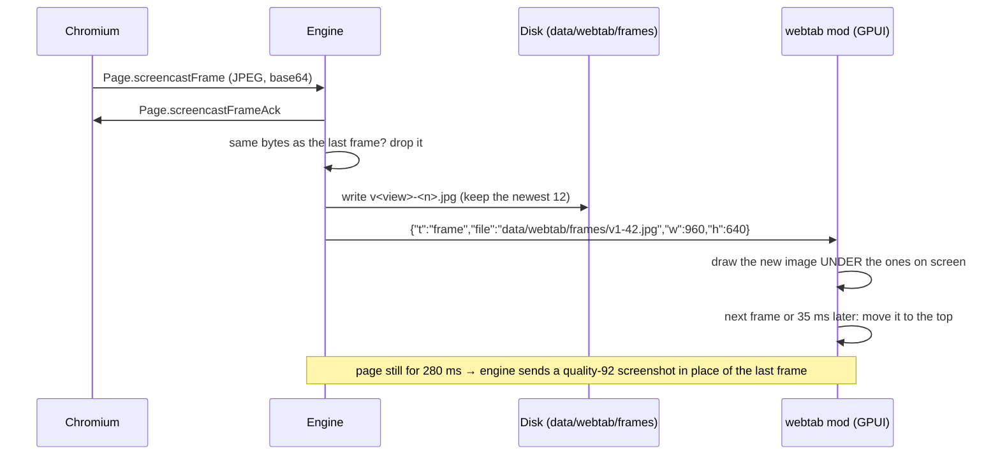
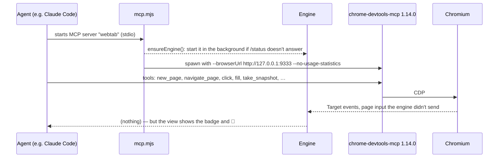

# How Herdr Web Tab works

This page explains the whole system with nothing left out: what runs, what talks to what, which files
change on your machine, and why each piece is built the way it is. For the message-level reference
(every command and event), see [architecture.md](architecture.md). For how we got here, see
[research.md](research.md). For how it is tested, see [testing.md](testing.md).

## The problem in one paragraph

The Herdr desktop app is written in Rust with [GPUI](https://www.gpui.rs/), the UI framework from
the Zed editor. GPUI draws everything itself on the GPU, and it has **no web view**. Herdr's mods are
JavaScript files that Herdr runs in its own runtime. They can build GPUI elements (`div`, `image`,
text inputs), open TCP sockets and WebSockets, read and write text files, and run programs. They
cannot embed a browser. So a browser tab in Herdr needs a real browser running somewhere else, plus a
way to get its pixels into a GPUI element and your input back into the browser.

## The pieces

| Piece | File | Runs where | Job |
|---|---|---|---|
| The view | `mods/webtab/main.js` (~440 lines) | inside Herdr | Draws frames, tab strip, toolbar, select menus, dialog cards, the driving badge, the console strip and the observe-only button. Turns your mouse and keys into messages. |
| The engine | `mods/webtab/node/webtabd.mjs` (~680 lines) | Node, detached | Launches and watches Chromium, streams frames to disk, replays input, tracks tabs, detects agents, forwards console messages, enforces observe-only, serves a small HTTP API. |
| Shared helpers | `mods/webtab/node/common.mjs` | Node | Config, finding a browser, display scale, starting/stopping the engine, closing Chromium safely. |
| The MCP launcher | `mods/webtab/node/mcp.mjs` | Node, one per agent | Starts the engine if needed, then hands stdio to chrome-devtools-mcp pointed at the shared browser. |
| Palette entry | `mods/webtab-new/` | inside Herdr | "New web tab" in the command palette: opens a `webtab` tab with a fresh id. |
| + menu row | `mods/new-menu-web/` | inside Herdr | A copy of Herdr's own + menu (taken from your install) with one more row, "Web tab". |
| Guard policy | `mods/webtab/node/guard.mjs` | Node | The rules, the command reader, the audit log, hook registration helpers. |
| Guard hook | `mods/webtab/node/guard-hook.mjs` | Node, once per agent shell command | Claude Code and Codex run it before each shell command; it denies, asks or logs. |
| Guard watcher | `mods/webtab/node/guardd.mjs` | Node, detached, one at a time | Reads Herdr's shell terminals through `hc` and flags risky commands typed there. |
| Guard notifications | `mods/webtab-guard/` | inside Herdr | Opened after an alert; posts one Herdr notification per new alert, then closes. |
| Installer | `install.mjs`, `uninstall.mjs` | Node, once | Put all of the above in place, register agents, and undo it all. |

Everything uses only Node's standard library. The one download is chrome-devtools-mcp, pinned to
1.14.0.

## From pixels in Chromium to pixels in Herdr

**Why files?** A GPUI `image()` element in a mod takes a path. There is no way to hand it bytes. And
a mod can't write binary files itself: in Herdr 0.1.18, `fs.writeFile(path, Uint8Array)` writes a
0-byte file (see [upstream.md](upstream.md)). So a separate Node process, the engine, receives the
frames and writes them as JPEG files under Herdr's app folder, and the mod draws them by path.

**Why draw under?** `image()` loads files asynchronously and draws nothing until the file is decoded.
Swapping straight to a new file makes the pane flash blank for a frame. The mod keeps the last three
frames stacked (`STACK = 3`) and inserts each new one at the bottom of that stack, where it is hidden.
On the next frame, or after 35 ms, it moves to the top. If several frames arrive in one socket read,
only the newest joins the stack. Our flicker test went from 3 blank grabs in 10 to 0 in 40 with this
(see [research.md](research.md#flicker)).

**Frame settings:** `Page.startScreencast` with JPEG quality 72, sized to the pane times the display
scale. On a 2× screen a 960×640 pane gets 1920×1280 JPEGs, drawn into 960×640 logical pixels, so
text is sharp. `Emulation.setDeviceMetricsOverride` sets the page's viewport and `deviceScaleFactor`
to match. Typical rates: 20 to 45 fps for moving pages; still pages send nothing until they change.

**Back-pressure:** if the mod stops reading (Herdr busy, or a retired copy of the mod after a reload),
stream frames are skipped once 256 KB are waiting on its socket, and a reader 8 MB behind is
disconnected, so one stuck view can't grow the engine's memory or slow the others.

## From your hand to the page

| You do | The mod sends | The engine does |
|---|---|---|
| Move, press, release, double-click | `mouse {type, x, y, button, buttons, clickCount, modifiers}` | `Input.dispatchMouseEvent`, one in flight at a time; moves coalesce to the newest |
| Scroll | `wheel {x, y, dx, dy}` | `Input.dispatchMouseEvent mouseWheel`; deltas add up while one is in flight |
| Type | `key {event}` / `text {text}` | `Input.dispatchKeyEvent` with the right `code`/`keyCode`, or `Input.insertText` |
| Ctrl+A/C/X/Z/Y | `key` with an editing command | `rawKeyDown` with CDP `commands: ["selectAll"]` etc., so the page sees real edit events |
| Copy | `copy` | reads `getSelection()`, replies `copied {text}`; the mod puts it on Herdr's clipboard |
| Paste (Ctrl+V) | `text {text}` with Herdr's clipboard | `Input.insertText` |
| Address bar, back, forward, reload | `navigate`, `back`, `forward`, `reload` | `Page.navigate`, history navigation, `Page.reload` |

Details that took testing to get right:

- **One input in flight.** Chrome acknowledges each input event. Sending moves as fast as they come
  queues hundreds of them during a drag, and the page trails your hand by seconds. The engine keeps
  one pointer event in flight, keeps only the newest move, and adds up wheel deltas. Presses and
  releases keep their order.
- **Drags leave the element.** GPUI fires `on_mouse_move`/`on_mouse_up` only over the element.
  While a button is held, the mod listens with `on_window_mouse_move`/`on_window_mouse_up`, so a drag
  that ends outside the pane still releases.
- **Keys GPUI wants for itself.** Tab, the arrows, Home/End and friends are matched by GPUI key
  bindings before a view's `on_key_down` sees them. The mod registers its own bindings under a
  `WebTab` key context (`cx.bind_keys`) and handles them as actions.
- **Cursor.** On mouse moves the engine asks the page for the computed `cursor` under the pointer and
  the mod switches between arrow, pointer and text cursors.
- **No script injection.** The engine runs a few small scripts in the page (`elementFromPoint`, the
  cursor probe). Only numbers ever go into those strings (`num()` coerces anything else to 0). A test
  sends `x: "0, 0); window.pwned = 1; (0"` and checks nothing ran.

## What headless Chromium can't draw, Herdr draws

Headless Chromium has no native widgets, so some things never appear in screencast frames:

- **`<select>` menus.** On a left press the engine checks `elementFromPoint`. If it's a select, it
  sends `select {id, selected, rect, options}` with option groups and disabled flags, and the mod
  draws a themed menu under (or above) the select. Up/Down/Home/End, letters, Enter or Space and
  Escape work. Picking sends `pick {id, index}`; the engine sets `selectedIndex` and fires `input` and
  `change`, like a real pick.
- **Dialogs.** `Page.javascriptDialogOpening` becomes `dialog {kind, message, value}`; the mod shows a
  card over the dimmed page (with a field for `prompt`), and the answer goes back through
  `Page.handleJavaScriptDialog`. Keys go to the card while it's open.
- **New windows.** When your click makes the page open a window (`target=_blank`, `window.open`),
  Chrome creates a new target with that page as its opener. The engine notices input from this view in
  the last 2 s and moves the view to the new tab, as a browser would.

## Tabs, windows, and the "dock"

Every browser tab is a CDP target. The engine subscribes to `Target.setDiscoverTargets` and keeps a
list of page targets; each view's tab strip shows them all, with 🤖 on tabs an agent touched in the
last eight seconds.

Two facts about headless Chromium shaped the design. We measured both
([testing.md](testing.md#background-tabs)):

1. **Only the front tab of a window paints.** A tab behind another gets no screencast frames at all,
   and a screenshot of it takes about 4 seconds.
2. **New tabs open in the newest window.** That includes an agent's `new_page` and `/json/new`.
   `Target.activateTarget` and `Page.bringToFront` don't change where they go.

So:

- each tab Herdr opens gets **its own window** (`Target.createTarget {newWindow: true}`);
- the engine keeps an empty **dock window** as the newest one. Tabs agents open land there, next to
  each other, instead of on top of the page you're watching. The dock's blank tab is hidden from the
  tab strip. If an agent uses it, or you start watching a tab in the dock, a new dock is made;
- a watchdog checks every second: if a watched page has sent no frame for 2.5 s and reports
  `document.visibilityState === "hidden"`, it's brought to the front;
- Chromium is started with `--disable-renderer-backgrounding`,
  `--disable-backgrounding-occluded-windows`, `--disable-background-timer-throttling` and
  `CalculateNativeWinOcclusion` turned off, so a page on screen in Herdr is never treated as a
  background page.

## Who is driving

The person and the agents use the same browser, so the engine has to tell them apart:

- When a view attaches, the engine adds a page binding and a capture-phase listener for
  `pointerdown`, `keydown` and `input`. If the page sees input within 600 ms of input sent from a
  Herdr view, it's yours. Otherwise it came from elsewhere: an agent.
- A tab that navigates when no view navigated it in the last 3 s, and a new tab with no opener page
  while nobody in Herdr asked for one, are agents' too.
- The view showing that tab gets `driver {who, why}`: the badge "Claude Code is driving" pulses for
  five seconds, and the address field gets an accent border.
- Agents can say who they are: `POST http://127.0.0.1:9441/claim?name=Claude%20Code` (optionally
  `&target=<id>` for one tab). A claim lasts ten minutes. Without a claim the badge says "An agent".
  The note the installer adds to `AGENTS.local.md` tells agents to do this.

## How agents get in

The launcher starts the engine **alongside** chrome-devtools-mcp, not before it: agents give MCP
servers a few seconds to answer, and chrome-devtools-mcp only reaches for the browser on its first tool
call. Anything that speaks CDP works the same way: Playwright or Puppeteer
`connectOverCDP("http://127.0.0.1:9333")`.

To show you a page, an agent runs
`herdr-app do tab.new '{"name":"🌐 Web","mod":"webtab","props":{"id":"<unique>","target":"<CDP target id>"}}'`.

## Lifecycle

- **Start on demand.** The mod, the MCP launcher and `--autostart` all run
  `node webtabd.mjs --detach`. That returns at once if `/status` already answers; otherwise it starts
  the engine detached and waits until it reports `ready`.
- **One engine.** The engine binds its ports before doing anything else. A second copy finds them taken
  and exits quietly.
- **Browser.** The engine attaches to a Chromium already listening on `cdpPort`, or launches one:
  `--headless=new --remote-debugging-port=9333 --remote-debugging-address=127.0.0.1
  --user-data-dir=<profile>` plus the flags above.
- **Browser dies or is closed.** The engine notices the browser WebSocket closing and relaunches. A
  closed headless Chromium closes its DevTools port at once but can take 10 to 30 s to exit, and holds
  the profile all that time; a new Chromium on the same profile then hands over to the old one and
  quits. So the engine asks Chromium for its real process id when it connects
  (`SystemInfo.getProcessInfo`), waits up to 3 s after a close, then ends that process tree
  (`taskkill /T /F` on Windows, the process group elsewhere). Then every view re-attaches.
- **Herdr reloads a mod** (you edit it, or Herdr updates). The old copy's socket is closed when its
  read loop fails, and each new copy reconnects and re-attaches to the tab it showed, saved in its own
  `localStorage`.
- **Stop.** `node webtabd.mjs --stop` posts `/quit` with the token; the engine closes Chromium and
  waits for it to exit, so the profile is free when the command returns.

## Pane identity

A mod opened with `tab.new` doesn't get its pane id in `props()` (only pane-header mods do). The
view needs it to rename its own Herdr tab after the page title. So the first time a copy starts it
takes the focused pane (the tab was just opened, so it's focused) and stores it in its own
`localStorage` (`paneId`). Copies opened with the same props share `localStorage`, so the palette
entry and the + menu always pass a fresh `id` prop.

## Watching without touching, and seeing what the page says

**Observe-only (👁).** The view stops sending input, and it tells the engine `observe {on: true}`; the
engine then drops every command from that view that could change the page (clicks, keys, text,
navigation, reload, new or closed tabs, dialog answers). Doing it in the engine means a bug in the
view, or a second copy of the mod, can't nudge a page an agent is working on. Agents drive over their
own CDP connections, so they aren't affected. The setting is saved per web tab, and
`"observe": true` in props starts a tab that way.

**The console strip (▤).** Each view also enables CDP's `Log` domain and forwards console messages,
uncaught exceptions and failed requests as `console` messages (capped at 100 a second). The view keeps
the last 300, clears them when a new page starts loading, and shows error and warning counts on the
toolbar button. It is read-only, so it's safe to keep open while an agent drives.

## Guard

Guard checks shell commands against a policy. Agents' commands are checked by a `PreToolUse` hook
**before** they run (the verdict is worked out in the hook process itself, so there's no daemon that
could be down); commands typed into Herdr's shell terminals are read off the screen by a watcher
**after** Enter and can only be flagged. Every catch goes to `data/webtab/guard/audit.jsonl` with
secrets redacted, and becomes a Herdr notification. The full story, with every rule and its limits,
is in [guard.md](guard.md).

## Security model

All three ports listen on `127.0.0.1` only.

| Door | Who may use it | How others are kept out |
|---|---|---|
| View socket :9440 | the webtab mod | First line must be `hello` with the token from `data/webtab/token` (24 random bytes, file mode 0600). Anything else, including an HTTP request, is dropped. |
| HTTP API :9441 | local tools, agents | Requests with an `Origin` header or `Sec-Fetch-Site` other than `none` get 403, so web pages can't call it. `Host` must be `127.0.0.1:9441` or `localhost:9441` (stops DNS rebinding). `/quit` also needs the token. |
| DevTools :9333 | agents, chrome-devtools-mcp | Chromium runs **without** `--remote-allow-origins`, so its WebSocket refuses connections from web page origins. Local programs can connect: that's the point. |

Other choices: the browser profile is its own folder (not your everyday browser), Edge is the last
browser picked (it can sign in to the OS account on its own), chrome-devtools-mcp runs with usage
statistics off, and page scripts only ever receive numbers.

Guard adds a check on agents' shell commands. It fails open on its own errors (logged), and like
everything here it can be changed by a process running as you; see [guard.md](guard.md).

What this does **not** protect against: any program running as you can reach the DevTools port and
drive the browser, the same as with any `--remote-debugging-port` browser. Don't sign in to accounts
in the web tab that you wouldn't let your agents use.

## What the installer changes

`node install.mjs` (flags in the README). Every change is undone by `node uninstall.mjs`.

| Step | Changes | Backup / undo |
|---|---|---|
| 1. Config | `<appHome>/data/webtab/config.json` (`node`, and `chrome`/`profile` if given) | kept with the profile; `uninstall.mjs --purge` deletes `data/webtab` |
| 2. Mods | copies `webtab`, `webtab-new`, `new-menu-web` into `<appHome>/mods/` (`mod.json` first, so Herdr never docks them into a layout), prunes files an older version left; copies your Herdr's `new-menu/main.js` to `new-menu-web/base.js` | folders removed |
| 3. `--menu` | in **your own** tab bar mods only (never Herdr's shipped ones), `openOverlay({mod: "new-menu"…})` → `"new-menu-web"`, height 512 → 560, marked `/* webtab: was 512 */` | `main.js.before-webtab`; the marker is reversed |
| 4. `--key` | adds `ctrl-shift-y` (or your chord) → `mod.open webtab-new` to `keys.json` under `global`, unless the chord is taken | `keys.json.before-webtab` |
| 5. Agents | `npm install chrome-devtools-mcp@1.14.0` into `data/webtab/mcp`; `claude mcp add --scope user webtab`; `codex mcp add webtab` or a marked block in `~/.codex/config.toml`; `webtab` in `~/.pi/agent/mcp.json`; a marked section in `<appHome>/AGENTS.local.md` | `.before-webtab` copies; marked blocks removed; `claude/codex mcp remove` |
| 6. Guard (skip with `--no-guard`) | seeds `data/webtab/guard/rules.json`; adds a `PreToolUse` entry (matcher `Bash\|PowerShell`) to `~/.claude/settings.json` and one (matcher `Bash`) to `$CODEX_HOME/hooks.json`, beside existing hooks; adds Guard to the agent note; says if Codex hooks are off | `.before-webtab` copies; only Guard's entries are removed |
| 7. `--autostart` | Windows Startup `herdr-webtab.vbs`, macOS `~/Library/LaunchAgents/dev.herdr.webtab.plist`, or Linux `~/.config/autostart/herdr-webtab.desktop` | removed |
| 8. Start | stops an older engine and Guard watcher, starts these, runs `herdr-app check` on each mod | — |

Herdr's own `AGENTS.md` tells agents to read `AGENTS.local.md` if it exists, and Herdr never writes
that file, so it's the right place for the note.

## Files at run time

| Path (under Herdr's app folder, e.g. `~/.config/herdr-app`) | What |
|---|---|
| `data/webtab/config.json` | your settings (see the README's table) |
| `data/webtab/token` | the view socket's token |
| `data/webtab/frames/v<view>-<n>.jpg` | the newest 12 frames per view |
| `data/webtab/webtabd.log` | engine log; start with `WEBTAB_DEBUG=1` for CDP timings, tab switches and visibility |
| `data/webtab/profile/` | the browser profile, unless you chose another |
| `data/webtab/mcp/` | the pinned chrome-devtools-mcp |
| `data/webtab/guard/rules.json` | your Guard rules |
| `data/webtab/guard/audit.jsonl` | Guard's log (rolls to `.old` at 1 MB; secrets redacted) |
| `data/webtab/guard/watcher.json` | the running watcher's pid and last poll |

## Known limits

- Frames go through disk: about a tenth of a second of extra delay, 20 to 45 fps. Video plays but
  isn't smooth.
- No file upload pickers, downloads, extensions, printing, or dragging files in from your desktop.
- Two web tabs showing the same browser tab share one viewport size.
- If Chromium crashes, the view is back in about 8 to 20 seconds on our test machine.
- Tested in Herdr on Windows 11. The engine, installer and MCP server are tested on Windows, macOS and
  Linux in CI; the mod inside Herdr on macOS and Linux hasn't been tried yet.
