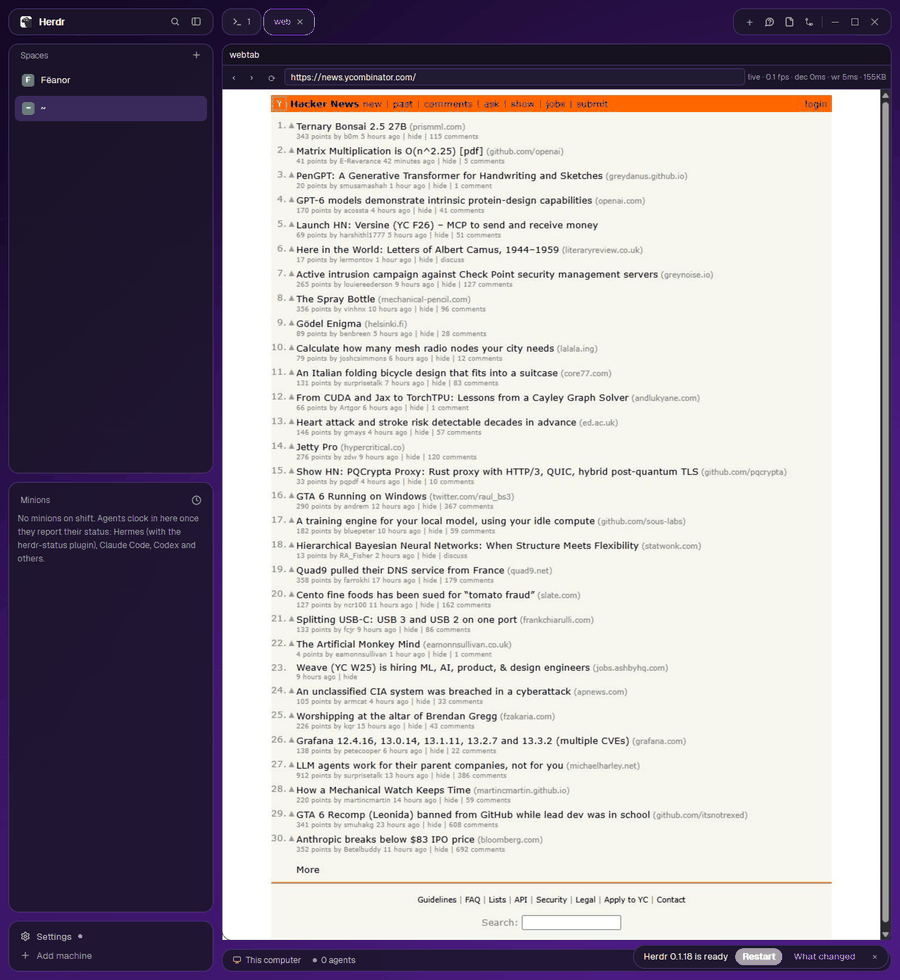
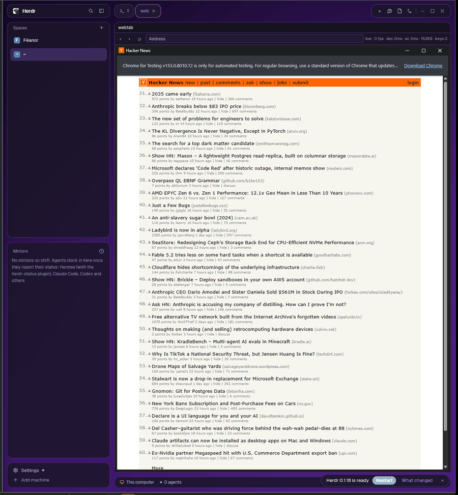
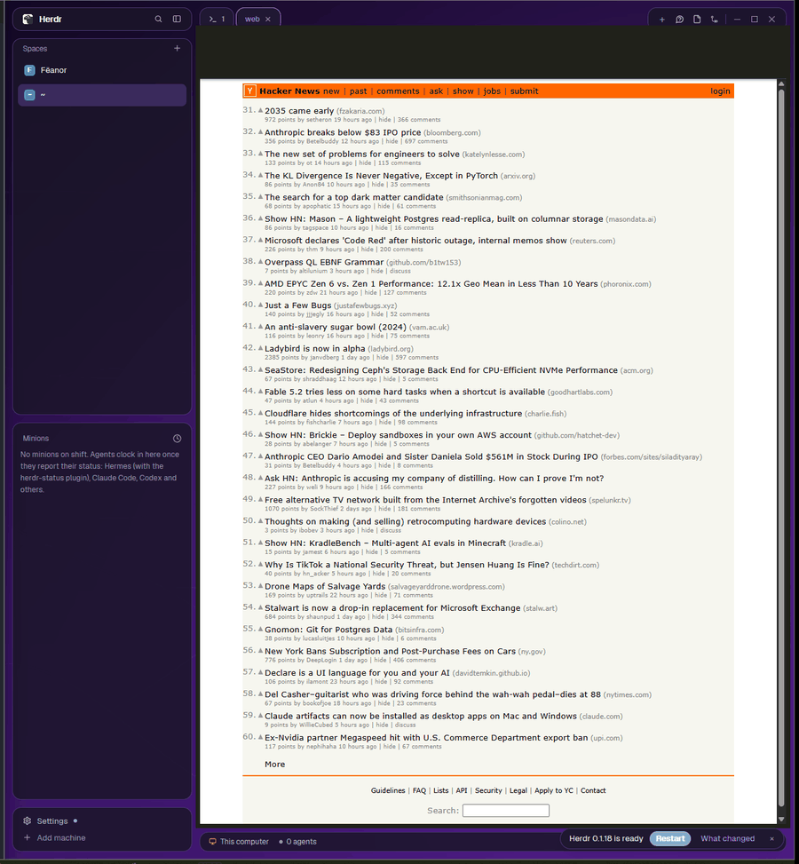
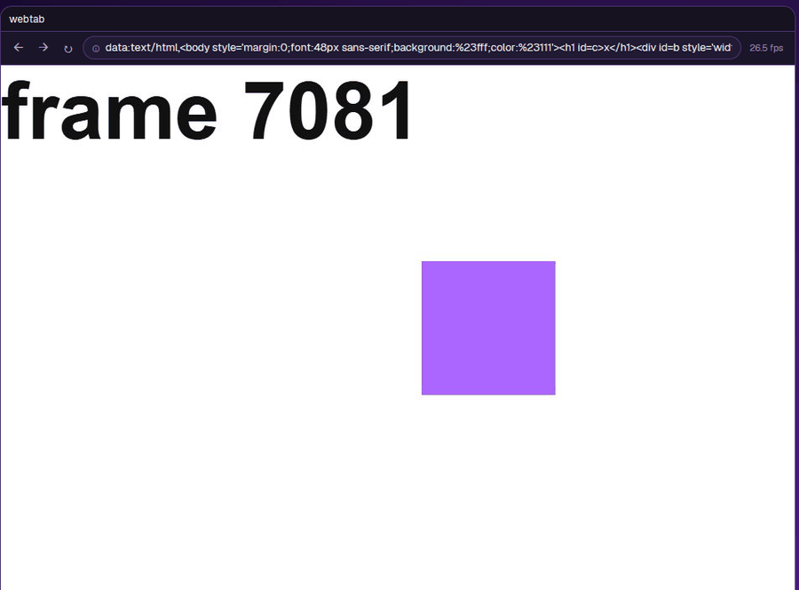
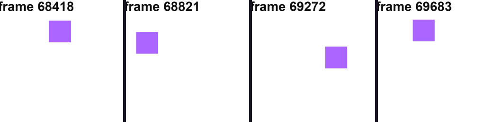

# Research: how we got to a browser drawn by Herdr

This is the R&D log behind Herdr Web Tab: the question, every approach we tried, what each one
showed, and why we kept one. The scripts are in [`experiments/`](../experiments/README.md) so you can
rerun them. All of this was done on Windows 11 with Herdr 0.1.16 to 0.1.18, an Intel i7-9700K and an
RTX 2070 SUPER, with Playwright's Chromium 1243 as the browser.

## The question

> What's the best way to open a web browser tab in the Herdr app that the person and the agents can
> all see and use?

Requirements that came out of it:

1. **It has to feel like Herdr.** A tab in Herdr's layout, in Herdr's theme, that moves, splits and
   hides with Herdr's panes.
2. **Agents drive the same page** the person sees, with their normal browser tools (CDP, MCP).
3. **No changes to Herdr itself.** Herdr's contributing guide asks for features as mods. A mod has to
   survive Herdr updates.
4. **Never steal focus.** The person may be in a full-screen app on another monitor while agents work.

## What a Herdr mod can and can't do

Herdr is a Rust app built on [GPUI](https://www.gpui.rs/). Mods are JavaScript run by Herdr, with:

- GPUI elements: `div`, `image(path)`, text inputs, scroll areas, timers, key bindings;
- `net` (TCP), `websocket`, `fs` (text works; binary doesn't, see below), `exec` (run programs);
- Herdr commands: `tab.new`, `pane.split`, `mod.open`, overlays, `localStorage`.

There is **no web view element**, and adding one would mean changing Herdr's Rust code. So every
option below runs a real Chromium outside Herdr and finds a way to show it.

## The options

| # | Approach | Result | Kept? |
|---|---|---|---|
| A | A mod talks CDP to headless Chromium directly and draws screencast frames with `image()` | Works, 12 fps, no web view needed | Became the design |
| B | Draw the page in a **terminal pane** with the Kitty graphics protocol | Works | No: a terminal, not a tab |
| C1 | Put a real, visible Chromium window **inside** Herdr's window as a child window | Flashes | No |
| C2 | Keep a real Chromium window **on top of** Herdr, owned by it, glued to the pane | Works, real browser, no flashing | No: rejected as not native |
| A2 | A + a Node **engine** that owns Chromium and writes frames, the mod only draws | 21 to 45 fps, no flicker | **Yes: this is Herdr Web Tab** |

### A. A mod that draws CDP frames itself

[`experiments/a-mod-direct-cdp/main.js`](../experiments/a-mod-direct-cdp/main.js)

The mod connects to headless Chromium's DevTools WebSocket with the mod runtime's `websocket`
client, calls `Page.startScreencast`, and draws each frame with `image()`. Mouse, keys and scrolling
go back as `Input.dispatch*Event`. An agent (`experiments/tools/agent.mjs`, a second CDP client)
navigates the same page, and the tab follows live.

*The first page drawn by Herdr itself: Hacker News, inside a Herdr tab, from CDP frames. The line at
the right of the address bar is the mod's own telemetry (frame rate, decode and write times, frame
size).*

What we learned:

- **Mods can't write binary files.** `fs.writeFile(path, new Uint8Array(…))` succeeds and leaves a
  0-byte file (also with `Buffer`). Strings are written fine. The workaround here was to wrap the
  base64 JPEG in an SVG (`<image href="data:image/jpeg;base64,…">`) and write that as text, which
  `image()` can draw. We filed this as a draft in [upstream.md](upstream.md).
- **12 fps** on a fully animated page; still pages only send a frame when they change.
- Writing a file per frame with rotating names, memory leveled off at about 258 MB with no leak.
- A real mouse click in the tab followed a Hacker News link; an agent navigating moved the tab.
- One WebSocket drop during a long run led to auto-reconnect.
- **Pitfall:** putting a mod's files in place before its `mod.json` (with `"place": "none"`) makes
  Herdr dock the new mod into your current layout. The installer always writes `mod.json` first.

The limit was speed and cost: base64 decoding and SVG wrapping in the mod runtime, on Herdr's UI
thread.

### B. Kitty graphics in a terminal pane

[`experiments/b-kitty-graphics/kittyweb.mjs`](../experiments/b-kitty-graphics/kittyweb.mjs)

Herdr's terminal panes understand the Kitty graphics protocol, and
[herdr-browser](https://github.com/ogulcancelik/herdr-browser) already streams CDP into the Herdr TUI
this way. We opened a pane with `herdr-app do pane.split` running this script: it sends PNG screencast
frames as Kitty APC chunks sized to the pane, and turns SGR mouse reports into CDP mouse events.

- It renders a real bitmap, correctly fitted to the pane.
- Two viewers on one page fight over `Emulation.setDeviceMetricsOverride`, so one viewer per page.
- It's a terminal: no address bar of Herdr's own, no Herdr theme, terminal key handling. It didn't
  meet requirement 1. (No screenshot of this one was kept.)

### C1. A real Chromium window as a child of Herdr's window

[`experiments/c-chromium-window/dock.py`](../experiments/c-chromium-window/dock.py)

The opposite idea: a real, visible browser, made to sit inside Herdr. The script launches Chromium in
`--app` mode with its own CDP port (so agents can still drive it), strips its frame, and
`SetParent()`s it into Herdr's window, positioned over the pane using bounds the mod writes to
`data/webtab/bounds.json`.

Re-parenting worked, but **the window flashed constantly**: Herdr redraws its whole DirectX surface
every frame, and the child window kept getting painted over.

### C2. A real Chromium window owned by Herdr, on top of the pane

[`experiments/c-chromium-window/dock2.py`](../experiments/c-chromium-window/dock2.py)

So we kept Chromium a separate top-level window, **owned** by Herdr's window (`GWLP_HWNDPARENT`):
always above Herdr, minimized with it, no taskbar button (`WS_EX_TOOLWINDOW`). Windows' compositor
draws both independently, so nothing flashes. The script follows the pane about 30 times a second,
hides the window when the tab isn't shown, and never activates it (`SW_SHOWNOACTIVATE`,
`SWP_NOACTIVATE`); we checked that a full-screen game kept the foreground.

*First placement: the Chromium window sits over the pane, but its own title bar and the "Chrome for
Testing … only for automated testing" bar come with it.*

*Clipped: the window is made larger than the pane and cut with `SetWindowRgn` so only the page shows
(93 px off the top, 7 px off the sides). That needed `--disable-direct-composition`: with
DirectComposition on, the clipped-away area painted solid black over Herdr instead of letting it show
through.*

This was a fully real browser: native typing, IME, video at full speed, DevTools. It had costs:
Windows-only code, Herdr's own menus and dialogs would open *under* it, and it is still a window on
top of Herdr rather than part of it. It was turned down for exactly that:

> It doesn't feel like Herdr native. I don't just want a floating Chrome window. I want to find a
> way to draw the browser using the GUI driver if possible.

That settled it: back to A, made fast.

### A2. An engine process plus a thin view

[`experiments/a2-first-engine/`](../experiments/a2-first-engine/)

Move everything heavy out of Herdr. A Node process (`webtabd.mjs`) owns Chromium, receives the
screencast, writes **real JPEG files** (Node can), and talks newline-delimited JSON to the mod over a
local socket. The mod only draws the newest file and sends input.

Result: **21 to 26 fps** on the first try, and later 20 to 45 fps. But it **flickered**: GPUI loads
an `image()` file asynchronously and draws nothing until it's decoded, so every new file showed as a
blank frame for a moment.

#### The flicker fix, and how we measured it

We needed a number, not an impression. The test page is a `data:` URL that draws a frame counter and
a moving purple square, so every screen grab should show purple:

`experiments/tools/flick.py` and `flick2.py` grab the pane's screen area 10 or 20 times in a row
(`grab.ps1`, a plain screen copy) and count grabs that are blank or have no purple pixels:

- **Before:** 3 of 10 grabs were blank.
- **Fix:** draw each new frame *underneath* the ones already on screen, and move it to the top on the
  next frame or after a short delay; use only the newest frame of a burst.
- **After:** 40 of 40 grabs clean.

That made it feel like a tab. Everything after this point is making A2 complete and reliable: real
input, dropdowns, dialogs, tabs, the agent badge, the + menu, packaging, and the engine fixes
described in [testing.md](testing.md).

## Other choices made along the way

- **Browser:** Playwright's Chromium (or any installed Chrome/Chromium/Brave). Edge was tried first
  and dropped: it signed in to the Windows Microsoft account on its own and started syncing. Edge is
  now the last browser the installer will pick, with a warning.
- **Agent tools:** chrome-devtools-mcp (from the Chrome DevTools team) attached to the shared browser
  with `--browserUrl`, pinned to one version so every agent runs the same one. Claude Code, Codex and
  pi all start it through one launcher.
- **Where agents learn about it:** Herdr's `AGENTS.md` tells agents to read `AGENTS.local.md` if it
  exists, and Herdr never writes that file, so the installer adds a marked section there.
- **The + menu:** Herdr's `new-menu` can't be extended and mods can't import each other, so we ship a
  copy that extends a local `base.js` (copied from your Herdr at install) and point only your own tab
  bars at it. [upstream.md](upstream.md) asks Herdr for a proper hook.
- **Ports:** 9440 (view socket), 9441 (HTTP API), 9333 (DevTools). All configurable.

## Ideas we didn't pursue

- **Patch Herdr to add a web view element.** It's the "real" fix for smoothness and would allow
  video at full speed, but it's a change to Herdr's core, against both Herdr's contributing guide and
  our own requirement 3. [upstream.md](upstream.md) lists the smaller Herdr APIs (draw an image from
  bytes, the window's scale factor, a pane's own id, a + menu hook) that would remove most of the
  workarounds.
- **WebRTC or a video stream** instead of JPEG files: nothing in the mod runtime can decode or draw
  video.
