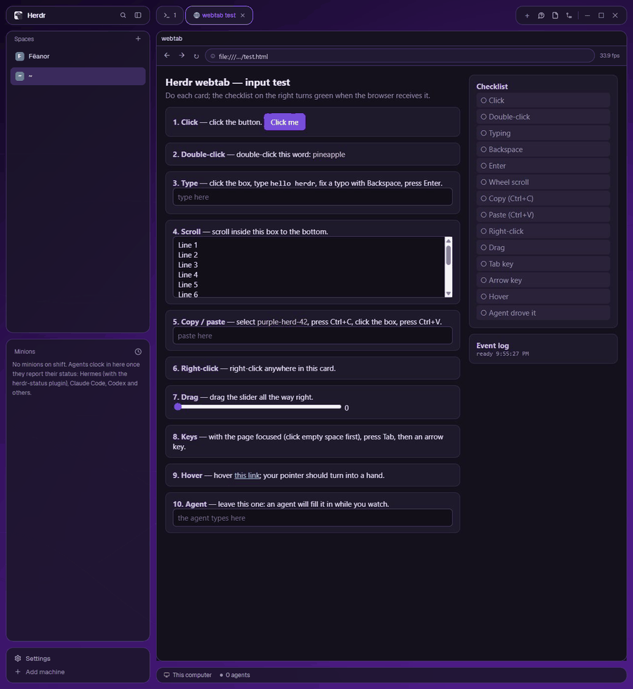
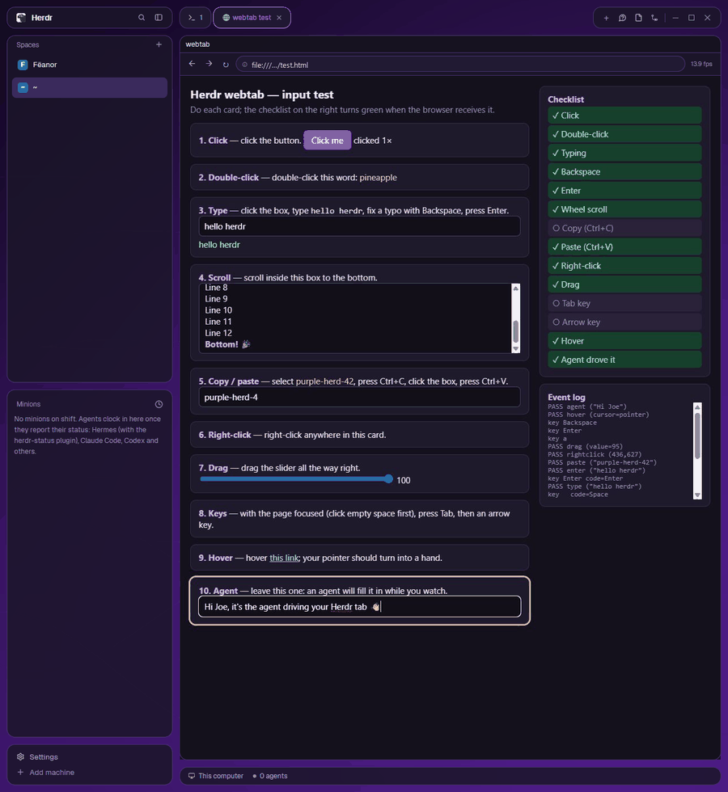
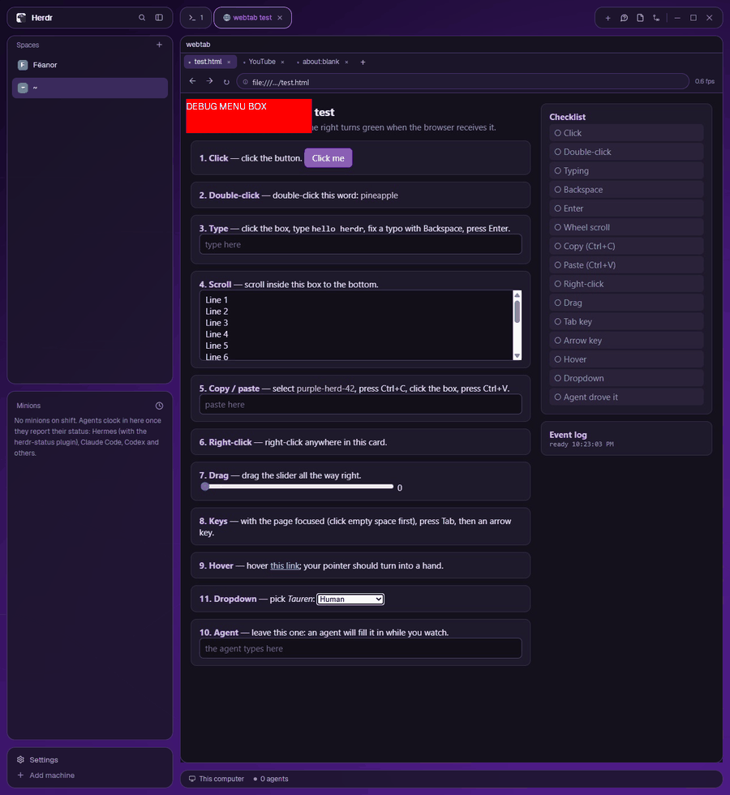
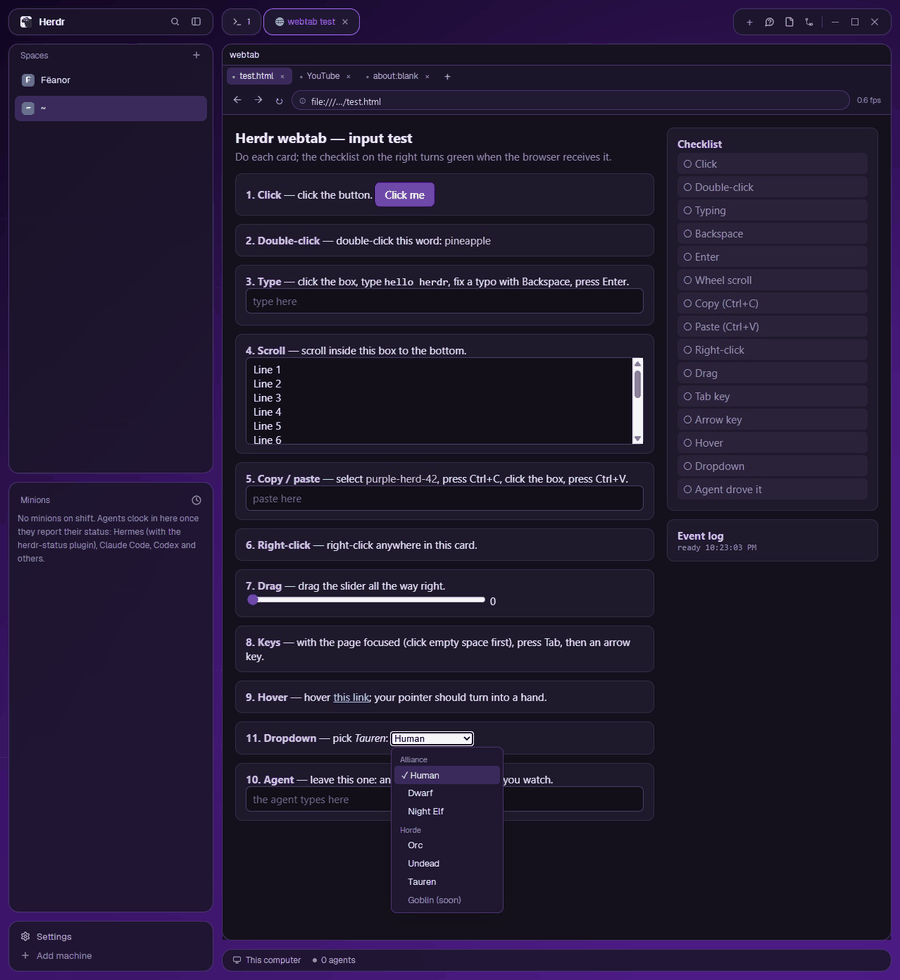
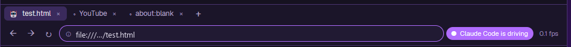
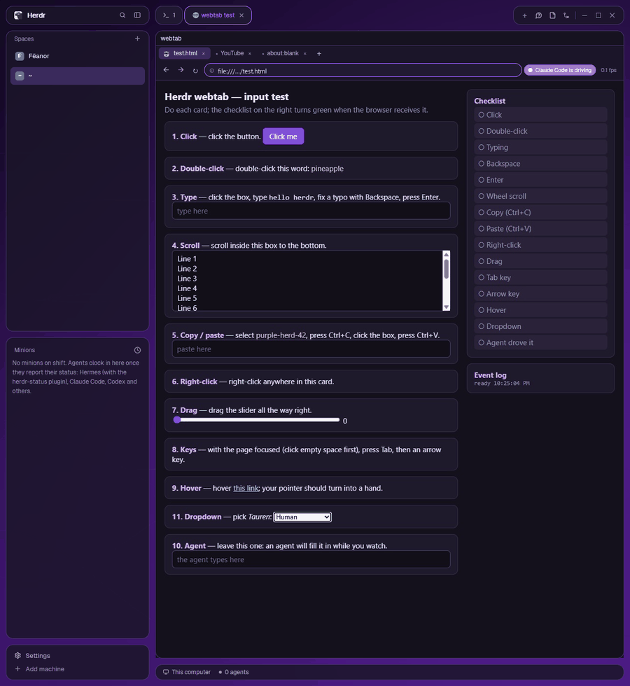
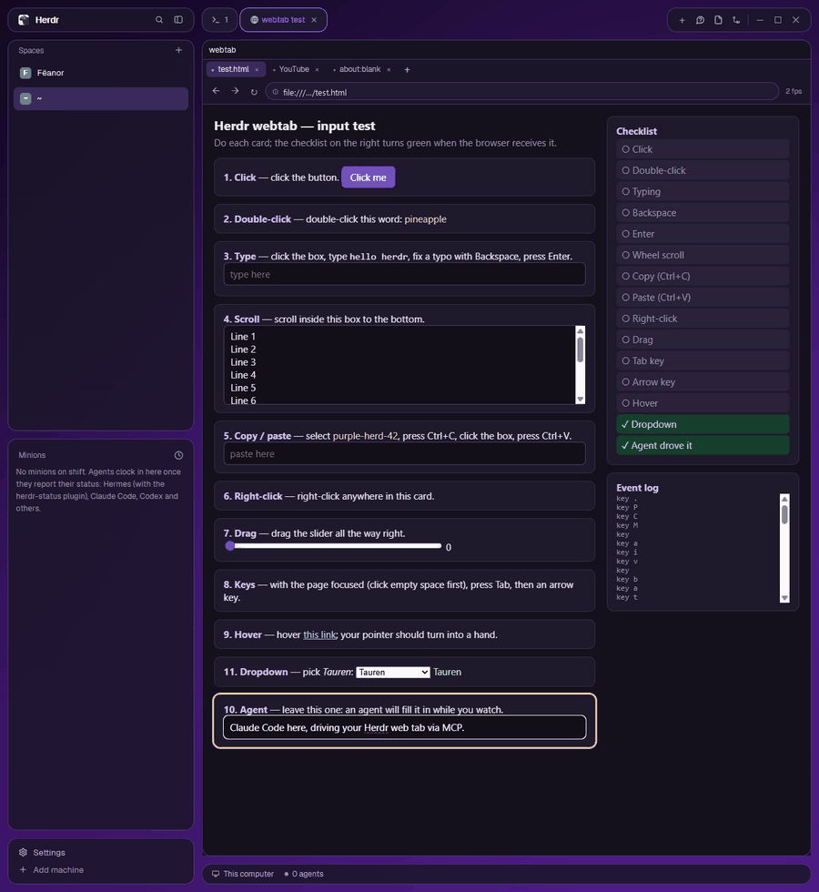
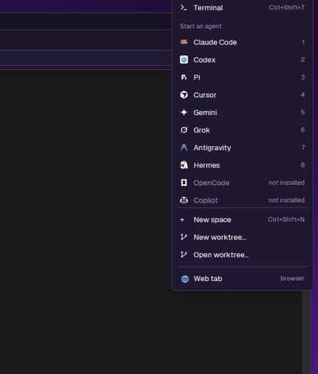
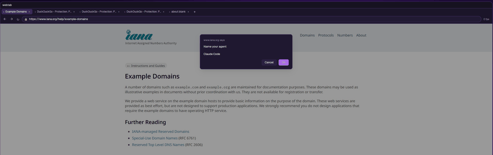

# Testing

How Herdr Web Tab is tested, why each test exists, and what the tests caught. There are four kinds:

1. **The automated suite** (`npm test`, 28 tests) against a real headless Chrome, in CI on Windows,
   macOS and Linux with Node 22 and 24.
2. **Hands-on tests inside Herdr**, with a test page that turns green as input arrives, and
   screenshots taken with `herdr-app shot`.
3. **Measurements and experiments** that answered design questions with numbers (scripts in
   [`experiments/`](../experiments/README.md)).
4. **Checks on the tests themselves:** mutation tests, and repeated runs to hunt down flaky ones.

The early experiments that chose the design (drawing with `image()`, Kitty graphics, a docked
Chromium window) are in [research.md](research.md).

## 1. The automated suite

```
npm test        # node --test --test-concurrency=1 "test/*.test.mjs"
```

Each engine test starts the real engine with a temporary Herdr app folder, random free ports and a
throwaway browser profile, and talks to it the way the mod does (the token handshake, then NDJSON).
Nothing touches your real Herdr setup or agent configs.

### Engine (`test/engine.test.mjs`)

| Test | Why it exists |
|---|---|
| status reports a ready engine and its browser | The mod, the MCP launcher and the installer all decide what to do from `/status`. |
| the HTTP API refuses web pages and DNS rebinding | Any web page you open could otherwise `fetch("http://127.0.0.1:9441/…")`. Requests with `Origin`/`Sec-Fetch-Site`, or a wrong `Host`, must get 403. |
| the browser's DevTools socket refuses web page origins | A page that could open the DevTools WebSocket would control the whole browser. Guards against anyone adding `--remote-allow-origins=*`. |
| the view socket needs the token | No token, a wrong token, or an HTTP request on the view port must be dropped. |
| a view attaches, gets frames as real JPEG files under the app home | The core path: frames exist, are JPEGs (checked by magic bytes) and live where `image()` can read them. |
| clicks and typing from the view reach the page | Input replay end to end, checked inside the page. |
| a `<select>` click becomes a menu message, and picking sets the value | Headless Chromium can't draw select menus; the engine must report options and apply the pick with `change` events. |
| page-side strings only ever get numbers | Sends coordinates like `"0, 0); window.pwned = 1; (0"` and checks nothing ran. |
| an agent navigating the page shows as a driver; a claim names it | The "who's driving" badge: a second CDP client navigates, and the view must get `driver`; with a claim, the right name. |
| tabs: new tab, tab list, switch back, close | The tab strip. |
| two quick switches end on the second tab, and the first never navigates it | A race found in use: clicking two tabs fast could leave the view on the first one, or navigate the wrong tab. |
| a page's `confirm()` reaches the view as a dialog, and the answer reaches the page | Dialogs block the page until answered; both directions must work. |
| a window the person's click opens takes the view along | `target=_blank` and `window.open` should behave like a browser. |
| the page on screen keeps updating when an agent opens a tab next to it | The headless "only the front tab paints" problem (see below). |
| a view that stops reading doesn't stall the others | A retired mod copy that stops reading must not freeze other tabs or grow memory. |
| a second engine leaves the first one alone | Many things start the engine; only one may run. |
| when the browser dies, the engine relaunches it and the view comes back | Chromium crashes or gets closed; the tab must recover by itself. |
| `--stop` ends the engine and its browser | Uninstall and upgrades depend on it. |

### Installer (`test/install.test.mjs`)

Runs `install.mjs` and `uninstall.mjs` against a **fake** Herdr app folder and a **fake** home folder,
with `--skip-mcp-download --no-start`, so no real agent CLI or config is touched.

| Test | Why |
|---|---|
| install puts every piece in place | Mods, `mod.json` with `place: none`, `base.js`, the + menu patch with its backup, `keys.json`, the agent note, Codex/pi config, autostart. |
| running install again changes nothing it shouldn't and prunes stale files | People re-run installers. No duplicate blocks, no double patches; files from older versions removed; "already set up" reported. |
| a key that's already taken is left alone | Never overwrite someone's key binding. |
| uninstall puts everything back the way it was | Byte-for-byte: tab bars, `keys.json`, `AGENTS.local.md`, Codex and pi configs. |
| install refuses a missing Herdr app home with a clear message | The most likely first-run mistake. |

### MCP (`test/mcp.test.mjs`)

**an agent's MCP server starts the engine on demand and drives the shared browser.** Starts
`mcp.mjs` the way an agent does (stdio, JSON-RPC), with no engine running: `initialize`,
`tools/list` (must include `list_pages`), then `new_page` with a titled page. It checks that the engine
came up by itself and that its tab list shows the agent's page.

### Static (`test/static.test.mjs`)

Every script parses; every `mod.json` has `"place": "none"` (otherwise Herdr docks the mod into your
layout) and the palette entry is right; **no personal paths or machine names** anywhere in the repo;
the agent note keeps the markers the installer needs.

### CI

[`.github/workflows/ci.yml`](../.github/workflows/ci.yml) runs the suite on `ubuntu-latest`,
`macos-latest` and `windows-latest` with Node 22 and 24 (six jobs), with Chrome from
`browser-actions/setup-chrome`.

CI caught one bug no local run showed: on **macOS with Node 24**, "a view attaches, gets frames"
timed out. That headless build sends no screencast frame for a page that never changes. The engine now
takes a screenshot after every attach and page load, so a still page always shows.

## 2. Hands-on tests inside Herdr

The engine tests can't show what Herdr draws. For that we used a test page,
[`test/fixtures/manual-test.html`](../test/fixtures/manual-test.html): numbered cards for every kind
of input, and a checklist on the right that turns green when the **page** receives each event, so a
pass means the input really arrived, not just that something was sent. Screenshots were taken with
`herdr-app shot`, which captures Herdr without focusing it, while the person was in a full-screen game
on another monitor. Clicks were sent the same way (synthetic, in the background).

### Input



*Start: every checklist item grey. The page runs in the web tab, inside Herdr's layout.*



*First pass: click, double-click, typing, Backspace, Enter, wheel scroll, paste, right-click, drag,
hover and the agent card are green. Copy, Tab and the arrow keys are not.* Those three led to fixes:

- **Tab and arrows never reached the view.** GPUI matches key bindings before `on_key_down`, and it
  binds those keys itself. Fix: the mod claims them with its own bindings under a `WebTab` key context.
- **Ctrl+C did nothing in the page.** Sending the key alone doesn't copy in headless Chromium. Fix: send
  it with CDP editing `commands` (`copy`, `cut`, `selectAll`, `undo`), and put the page's selection on
  Herdr's clipboard.
- **Drags lagged and sometimes stuck.** Chrome acks each input event, so moves queued up; and the
  release was lost when the pointer left the pane. Fix: one pointer event in flight with moves
  coalesced, and window-level move/up handlers while a button is held.

After these, all 14 checks passed. (The second-pass screenshot wasn't kept.)

### Dropdowns

Card 11 is a `<select>` with option groups (Alliance, Horde) and a disabled option, because those are
the cases a home-made menu gets wrong.



*The first version logged the click and the select's options, but no menu appeared. A temporary red
"DEBUG MENU BOX" proved the overlay itself rendered, so the bug was layout. Three causes: a debug
variable used before it was set (Herdr's "could not be re-rendered" banner), a scroll area with only a
max height collapsing to zero, and GPUI's scrollbar wrapper dropping absolute positioning.*



*Fixed: the menu draws under the select with "Alliance" and "Horde" headers, the current option
highlighted and "Goblin (soon)" dimmed. Picking Tauren turns "Dropdown" green.*

A second dropdown bug only showed after waiting: **picks made after about 30 seconds did nothing.**
Herdr's socket reads time out after ~30 s without data, so an idle page silently lost its connection.
The engine now sends a `ping` every 10 s.

### A real agent driving the tab

This test used **Claude Code itself** (a headless `claude -p` run with the installed `webtab` MCP
server), not a script. It was asked to claim the browser, pick the page already open, and fill card 10.
Claude Code reported: "I claimed the tab, selected the page that was already open (`webtab test`, page
1, no new page), took a snapshot and filled the box."





*While it works, the toolbar shows "● Claude Code is driving" (from its `/claim`), and the address
field gets an accent border.*



*Result: card 10 reads "Claude Code here, driving your Herdr web tab via MCP.", typed through
chrome-devtools-mcp into the same page, and "Agent drove it" is green. The page saw input that didn't
come from Herdr and counted it as the agent's.*

Before that, a stand-in agent ([`experiments/tools/agent-turn.mjs`](../experiments/tools/agent-turn.mjs),
a plain CDP client) did the same during the first input pass, which is the green agent card above.

The badge test also changed a rule: originally a claim with no tab named every web tab as driven.
Now only a claim for a specific tab shows the badge at once; a general claim just names the agent the
next time it acts.

### The + menu



*`new-menu-web` is Herdr's own + menu (copied from the installed Herdr) with a "Web tab" row added.*

Clicking it twice opened **two tabs showing the same page**: both copies had the same props, so they
shared `localStorage` and one saved state. Fix: each opening passes a fresh `id`, and each copy
remembers its own pane. A follow-up bug: new tabs kept the name "🌐 Web" because the pane id wasn't
known yet when the title arrived; the rename now retries on render.

Screenshot coordinates were another trap: `herdr-app shot` saves at twice the click coordinates on
this machine, so the first clicks landed on the wrong buttons until we halved them.

### Dialogs



*`prompt('Name your agent', 'Claude Code')` on iana.org: Herdr draws the card in its theme over the
dimmed page; OK and Cancel answer the page. Keys go to the card while it's open.*

### The finished tab

The README's [preview](../preview.png) is the final check: herdr.dev in a web tab, two browser tabs in
the strip, the address bar and 30 fps, no error banners.

The full manual checklist to repeat before a release is in [manual-test.md](manual-test.md).

## 3. Measurements and experiments

<a id="background-tabs"></a>
### Why did the page freeze when an agent opened a tab?

Three engine tests failed now and then: popups, "keeps updating when an agent opens a tab", and the
browser relaunch. Running the suite in a loop with `WEBTAB_DEBUG=1` caught a failing run:

```
04:47:21.155 target created 99BED4 opener - about:blank     ← an agent opens a tab
04:47:22.850 view 1: hidden (F5CADC)                        ← the watched page goes hidden
04:47:29.486 view 1: Page.captureScreenshot timed out
04:47:32.148 browser connection lost; reconnecting
```

So we measured headless Chromium directly, without the engine.

[`experiments/engine/vis-exp.mjs`](../experiments/engine/vis-exp.mjs): one window, a page that changes
every 50 ms, then a second tab opened in front of it.

| Page | Screencast |
|---|---|
| front tab | 20 fps |
| behind another tab | **0 fps** |
| behind, with focus emulation | 1 fps |
| behind, with lifecycle state forced active | 2 fps |
| screenshot of a tab behind | **3,964 ms** |

[`experiments/engine/vis-exp2.mjs`](../experiments/engine/vis-exp2.mjs): two windows.

| Question | Answer |
|---|---|
| Do pages in separate windows both paint? | Yes, both at 20 fps |
| Where does `Target.createTarget` (no `newWindow`) put a tab? | In the **newest** window |
| Where does `/json/new` put it? | In the newest window |
| Does `Target.activateTarget` or `Page.bringToFront` change that? | No |

That is the reason for the window design in [how-it-works.md](how-it-works.md#tabs-windows-and-the-dock):
each watched tab in its own window, and an empty "dock" window kept newest to catch agents' tabs.

### The rest of the flaky failures

With the windows fixed, the loop kept finding smaller bugs. Each was confirmed in the debug log,
fixed, and the loop re-run:

| Symptom | Cause | Fix |
|---|---|---|
| Frames from the previous tab, or a false "hidden", right after switching | A closing page connection still delivered events | Ignore events from any page socket but the current one |
| Page frozen after closing a popup | Chrome activates the popup a moment after creating it | Watchdog: no frames for 2.5 s and `visibilityState` hidden → bring to front |
| Tab switching fighting Chrome's own | `bringToFront` on every attach | Only when the page reports it's hidden |
| Relaunch never finished | The engine opened a tab in a browser that was shutting down | Leave recovery to the reconnect when the browser socket is gone |
| "Chromium did not open its DevTools port" | The old Chromium still held the profile (below) | Wait for it to exit, then end it |
| Engine crash on relaunch | `ChildProcess.unref()` returns nothing, not the process | Keep the process object |
| Everything slow during the hunt | Two Chromiums orphaned by killed test runs, still using CPU | [`orphans.ps1`](../experiments/tools/orphans.ps1) found and ended them; tests now close their tabs |

### How long does a closed Chromium take to exit?

Recovery after a browser crash took 15 to 17 seconds. [`experiments/engine/close-exp.mjs`](../experiments/engine/close-exp.mjs)
sends `Browser.close` and times the DevTools port and the process separately:

| Browser | DevTools port closed | Process exited |
|---|---|---|
| Google Chrome (stable, headless) | 0.1 s | **more than 30 s** |
| Playwright Chromium 1243, one window | 0.2 s | 11.0 s |
| Playwright Chromium 1243, three windows | 0.3 s | 15.5 s |

While it lingers, it holds the profile, and a new Chromium on that profile hands over to it and
exits. [`experiments/engine/pid-exp.mjs`](../experiments/engine/pid-exp.mjs) confirmed that
`SystemInfo.getProcessInfo` returns the real browser process id (the same as the spawned pid for both
browsers), so the engine can end exactly that process tree after 3 s instead of guessing.

[`experiments/engine/dbg-recover.mjs`](../experiments/engine/dbg-recover.mjs) kills the browser three
times in a quiet engine and times the view's return. It also served as a control:

| Variant | Back after (3 rounds) |
|---|---|
| before the fix | 17.0 s, 14.7 s, 16.4 s |
| without the background-throttling flags | 16.1 s, 16.3 s, 14.3 s (flags aren't the cause) |
| without dock windows | 56.9 s, 8.6 s, 16.5 s (docks aren't the cause) |
| after the fix | 7.2 s to 19.7 s |

It's reliable now but still not fast: on the test machine most of the remaining time is Chromium
starting up again. That's listed as a known limit.

## 4. Testing the tests

**Mutation tests.** A security test that never fails is worse than none. We broke the code on
purpose and checked the right test failed:

- Re-adding `--remote-allow-origins=*` to Chromium's flags → "the browser's DevTools socket refuses
  web page origins" failed. ✔
- Removing the number coercion from page scripts → the injection test still **passed**: its first
  payload never produced code that ran. It was changed to `x: "0, 0); window.pwned = 1; (0"`, which
  does run when pasted into an unescaped `elementFromPoint(${x}, ${y})`. Now the mutation makes it
  fail, as it should. ✔

**Repeated runs.** Through the last rounds of fixes the engine suite passed 24 runs in a row locally
(each run starts and kills real browsers), and then all six CI jobs.

## Rerunning any of this

- `npm test` for the suite. `WEBTAB_SKIP_MCP_TEST=1` skips the MCP test offline;
  `WEBTAB_MCP_DIR=<dir>` points it at an installed chrome-devtools-mcp.
- `WEBTAB_DEBUG=1 node mods/webtab/node/webtabd.mjs` for the engine's debug log.
- The experiment scripts: see [`experiments/README.md`](../experiments/README.md).
